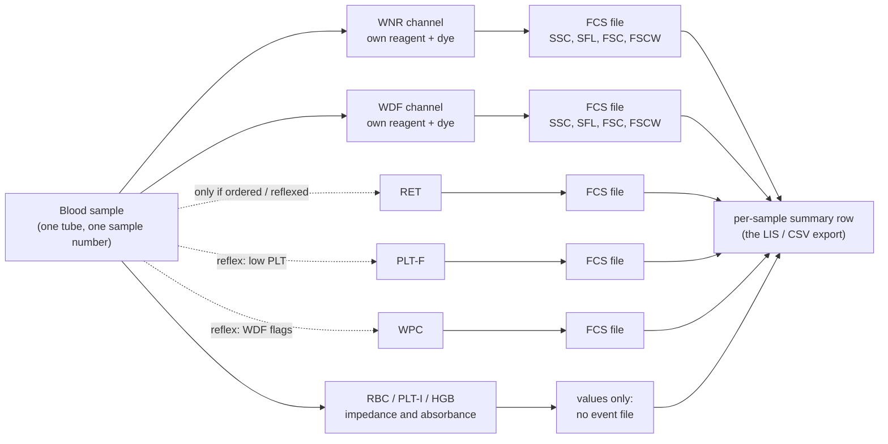
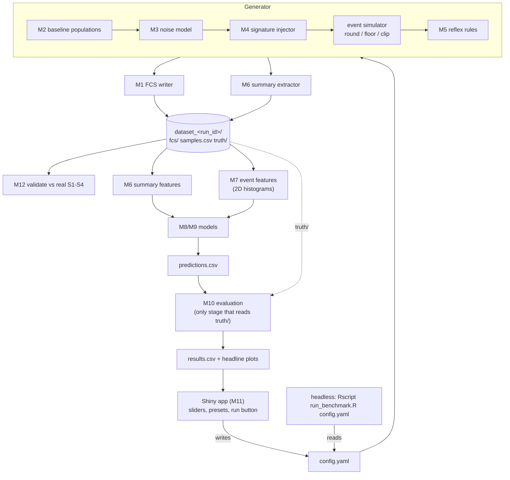

# Hackathon plan: how small a signal can ML find in haematology analyser data?

*A detection-limit benchmark built on synthetic Sysmex XN data.*

How to read this: sections 1–3 are for everyone (about 4 minutes). Section 4 is the data contract, and the part we most need to agree on before we split up. Sections 5–9 cover who builds what, what we demo, and what could go wrong.

Labels used throughout:
- **CONFIRMED (`file`)**: measured from the four real files. The file named is the repo output it comes from.
- **ASSUMED**: our extrapolation. Each one has a risk rating in section 3.
- **TBD**: a number we don't have yet. It becomes a config parameter rather than a guess.

---

## 1. Pitch

Every full blood count (FBC) on a Sysmex XN analyser passes tens of thousands of individual cells through a laser. The lab report keeps only a few dozen summary numbers. We'll build a generator for **realistic synthetic XN data**: per-cell files in the analyser's real file format, plus the per-sample summary table a lab would export. Into some samples we plant a "disease" signature whose strength we control. Then we hide the labels and measure the **smallest planted effect a model can reliably detect**.

That answers two questions:

1. **How big must a signal be before ML can find it,** given realistic biological and instrument noise?
2. **How much signal does the routine per-sample summary throw away compared with the per-cell data?** This is the main hook. Every experiment runs twice, once with summary-level models and once with event-level models, and we compare the two detection curves.

The signature doesn't need to be a real disease. The deliverable is a **calibrated ruler**. If someone proposes "ML on FBC data will detect X", our curves show roughly how large X's effect on the cells must be for that to work.

---

## 2. Background in plain English

**FCS (Flow Cytometry Standard)** is a file format. Each file has a text header of `key/value` pairs (called *keywords*) followed by a table with one row per cell (an *event*) and one column per measured signal (a *parameter*).

**A channel** is one physical measurement run inside the analyser. For each blood sample, the XN takes a separate small portion of blood for each channel. It adds that channel's own lysing reagent, which destroys some cell types and leaves others, and its own fluorescent dye, which stains nucleic acid. It then streams the cells one by one past the **same** laser and detectors. Because the hardware is shared, **every channel records the same four signals**:

| Signal | What it measures, roughly |
|---|---|
| **SSC** (side scatter) | internal complexity and granularity |
| **SFL** (side fluorescence) | how much dye the cell took up (nucleic-acid content and activity) |
| **FSC** (forward scatter) | size |
| **FSCW** (forward-scatter pulse width) | how long the cell took to pass the beam, which also tracks size |

What changes between channels is the chemistry, so the **same four axes show different cell populations in different places**:

| Channel | What it reports | When it runs |
|---|---|---|
| **WNR** | white cell count, nucleated red cells (NRBC), basophils | every FBC |
| **WDF** | white cell differential (neutrophils, lymphocytes, monocytes, eosinophils, immature granulocytes) plus research **cell population data** | nearly every FBC |
| **RET** | reticulocytes, IRF, RET-He, optical platelet count | only when ordered or *reflexed* |
| **PLT-F** | fluorescent platelet count, IPF | reflexed, e.g. on a low platelet count |
| **WPC** | blast and abnormal-lymphocyte flags | reflexed on WDF flags (XN-20 module only) |
| RBC / PLT-I / HGB | red cells, platelets, haemoglobin | always, but measured by impedance and absorbance, which give histograms rather than per-cell events, so **no FCS file** |

Definitions:
- **Cell population data (CPD):** summary numbers the analyser computes for each white cell cluster: where its centre sits on each axis (e.g. NE-SFL, the neutrophil fluorescence) and how wide it is (e.g. NE-WY, the spread of neutrophil fluorescence).
- **Reflex:** the analyser's rule engine runs an extra channel automatically when a first result looks abnormal. Which channels exist for a sample therefore **depends on its results**. That's a real-world route for label information to leak, and our generator reproduces it on purpose (section 4.4, `reflex`).



---

## 3. What we know vs what we're assuming

The repo characterises four **real, public** XN FCS files: Kaku et al. 2018, PLOS ONE, supplementary S1–S4. They are malignant pleural effusions run in body-fluid mode, WDF channel only.

| Confirmed from the real files (source) | Assumed / extrapolated (risk) |
|---|---|
| FCS3.0, one dataset per file, no ANALYSIS or supplemental TEXT segment, no trailing CRC (`schema.json` → `file_structure`) | **ASSUMED:** whole-blood mode writes **one FCS file per channel per sample**, linked by sample number and timestamp. **Risk: medium.** We've only seen WDF. The `$FIL` pattern does suggest one file per measurement |
| TEXT starts at byte 58, delimiter `/` (ASCII 47), TEXT ends with a delimiter, 42 keywords per file (`report.md` §1) | **ASSUMED:** WNR, RET, PLT-F and WPC files use the **same 4-parameter, 8-bit layout**. **Risk: low–medium.** The hardware is shared, but nobody has published one of these files |
| `$DATATYPE I`, `$BYTEORD 1,2,3,4` (little-endian), `$MODE L`, 4 bytes per event (`schema.json` → `encoding`) | **ASSUMED:** cluster positions for **WNR, RET, PLT-F and WPC**, taken from published scattergram images and relative positions only. **Risk: high**, and it's the biggest realism gap |
| Parameters in the order **SSC, SFL, FSC, FSCW**, each `$PnB 8`, `$PnR 256`, `$PnE 0,0`, with `$PnS` long names; no time or label parameter; no `$PnG/D/V` (`parameters.csv`) | **ASSUMED:** whole-blood WDF cluster positions differ from body fluid. **Risk: medium.** Body-fluid positions are measured; whole-blood ones come from the literature |
| All values are integers 0–255 and nearly every level is used (up to 256 distinct values), so this is genuine 8-bit data (`report.md` §3) | **ASSUMED:** 8-bit values are display resolution, not raw detector resolution (`findings_reviewed.md` §3 calls this an inference). **Risk: low for us**, because we copy what's exported |
| Complete, ungated event lists: `$TOT` equals the row count in all four files (`report.md` §4) | **ASSUMED:** whole-blood event counts per channel. **Risk: medium. TBD.** We only have body-fluid counts |
| **FSC floor at 10**: minimum FSC is 10 in every file, a trigger threshold (`event_summary.csv`, `findings_reviewed.md` §4) | **ASSUMED:** a per-sample tabular export (IPU CSV / LIS) exists with FBC values, CPD and flags. The XN Administrator's Guide (per the brief) says CSV exports split above 256 columns and leave out patient information by default. **Risk: low** that it exists, **medium** on exact column names |
| **Debris spike at SFL = 0**: 0.75% (S1), 2.65% (S2), 2.78% (S3), 8.83% (S4) of events (`report.md` §4) | **ASSUMED:** CPD values in the CSV are on the **same scale** as the 8-bit FCS values. **Risk: high.** Published CPD cut-offs such as NE-WY 654 and MO-WY 800 (Mishra 2021) are far above 255, so the CSV uses a different, finer scale. See section 9 |
| **Saturation at 255**. SFL: 25.2%, 8.04%, 4.98%, 2.83%. FSC: 16.5%, 3.24%, 1.09%, 0.79%. SSC: 1.54%, 0.54%, 0.35%, 0.08% (S1–S4; `report.md` §4) | **ASSUMED:** noise-model magnitudes such as between-patient CV and factor loadings. **Risk: medium.** "Realistic" preset values come from published CPD reference ranges, which first need the scale conversion above |
| FSCW lower edge curves upward with FSC (pulse physics, visual review: `findings_reviewed.md` §4) | **ASSUMED:** reflex rules and their thresholds. **Risk: low.** They're configurable and plausible, but each lab sets its own |
| Event counts **4,313 – 45,143** per file (S1 45,143; S2 4,602; S3 4,313; S4 4,915) (`schema.json` → `event_count`) | **ASSUMED:** FCS export is available on routine NHS analysers. **Risk: high for real-world use, none for the hackathon** (plan B in section 9) |
| Body-fluid WDF layout, visual: lymphocytes about SSC 70 / SFL 50; neutrophils about SSC 140–160 / SFL 35; a diagonal high-SFL band of monocytes, macrophages and atypical cells (`findings_reviewed.md` §5) | |
| `$CYT = XN-20` (the analyser module), `$CYTSN = 11569`, `$SYS = Windows 7`, `$ORIGINALITY = Original` (an FCS 3.1 keyword in a 3.0 file), `$ETIM` present but **no `$BTIM`** (`schema.json`, `findings_reviewed.md` §6) | |
| `$FIL` shape `[XX-99^99999][99-99_9][99999999_999999][<17 spaces>XX-99].999`; `$SMNO` shape `XX-99`; `$DATE` shape `99-99-9999`; `$CELLS` is 2 letters; `$COM` is 6 letters; `$CELLS` and `$COM` are constant across files (`keywords_all.csv`, redacted shapes) | |

**What four body-fluid files cannot tell us** (`schema.json` → `not_inferable_from_these_files`): whole-blood counts and positions; any channel other than WDF; normal (non-malignant) samples; instrument-to-instrument and day-to-day differences; whether other software versions export differently.

---

## 4. The data structure

### 4.1 Output folder for one generated dataset

One **dataset** is one draw of the generator at one setting: a cohort of samples, some carrying the signature. A **sweep** (section 4.6) produces many datasets.

```
<output_root>/                                  # from config; nothing hard-coded
  sweep_<sweep_id>/
    sweep_config.yaml                           # the grid that produced the datasets below
    results.csv                                 # one row per dataset × model (evaluation output)
    dataset_<run_id>/                           # run_id = <grid_cell_id>_s<seed>, e.g. g017_s03
      config.yaml                               # exact, fully resolved generator settings (reproducible)
      samples.csv                               # per-sample summary table: what a lab CSV export would hold
      splits.csv                                # sample_id, fold (fixed train/test folds; models may read)
      fcs/
        SYN000001/
          XN-20^90001_20261101_093012_SYN000001_WNR.fcs
          XN-20^90001_20261101_093012_SYN000001_WDF.fcs
          XN-20^90001_20261101_093012_SYN000001_RET.fcs    # only when RET was run
        SYN000002/
          ...
      truth/                                    # HIDDEN from models: never read by M7–M9
        truth.csv
        events/                                 # optional per-event truth (population + affected flag)
          SYN000001_WDF.csv.gz
      qc/                                       # generator validation outputs (M12)
        fcs_roundtrip.csv
        compare_to_real.csv
        figures/
```

**File naming** follows the real `$FIL` pattern `[<$CYT>^<$CYTSN>][<field2>][<YYYYMMDD_hhmmss>][<$SMNO right-justified>].<3 digits>`:
- On disk we drop the brackets and padding, which are unsafe in shells and on Windows sync tools, and append the channel: `<$CYT>^<$CYTSN>_<YYYYMMDD_hhmmss>_<$SMNO>_<CHANNEL>.fcs`.
- The **`$FIL` keyword inside the file keeps the exact real shape**, so the validator (M12) can compare it.
- **ASSUMED:** the real files carry no channel name in any keyword or in `$FIL`, which makes sense because only WDF was exported. We put the channel **only in the on-disk filename**, so the keyword set stays identical to the real one.
- Sample IDs are fabricated and visibly synthetic (`SYN000001`). Serial numbers are fabricated too: we don't reuse the real `$CYTSN`.

**Writing FCS in sweeps is optional.** A sweep might be 100 grid cells × 5 seeds × 1,000 samples × 2–5 channels, which is a lot of small files. In sweep mode the generator passes events to the feature builders in memory (`write_fcs: false`). Full FCS output is for demo datasets and validation. A round-trip test (M1) guarantees that the in-memory route and the file route give identical features.

### 4.2 FCS file spec (one file = one sample × one channel)

Taken from `outputs/schema.json`. The writer must reproduce it **byte for byte in structure**.

**Layout**

| Segment | Rule | Source |
|---|---|---|
| HEADER | `FCS3.0` + 4 spaces + six 8-byte offset fields (TEXT begin/end, DATA begin/end, ANALYSIS begin/end = 0). TEXT begins at byte **58**; no OTHER segments | CONFIRMED `schema.json` |
| HEADER field padding | space- or zero-padding of the six HEADER fields isn't recorded in the outputs | **TBD**: read from the raw files with `py/fcs_raw_parse.py` (`raw_fields`) |
| TEXT | `/`-delimited, starts and ends with `/`, 42 keywords, keyword order **TBD** (copy from the raw TEXT) | CONFIRMED `report.md` §1 |
| DATA | `$TOT` × 4 bytes, each event as `SSC, SFL, FSC, FSCW`, 1 unsigned byte each | CONFIRMED |
| After DATA | nothing: file size = `$ENDDATA` + 1 (S1: 181,303 bytes; `$ENDDATA` 0000181302 = 731 + 45,143×4 − 1) | CONFIRMED `report.md` Inputs + `schema.json` |

Because the offset keywords are **fixed-width (10 digits, zero-padded)**, the TEXT length doesn't depend on the offsets. The writer can compute `$BEGINDATA` in one pass, with no iteration.

**Keywords (all 42)**

| Keyword | Real value or shape | In synthetic files | How |
|---|---|---|---|
| `$BEGINANALYSIS`, `$ENDANALYSIS` | `0000000000` | fixed | copy |
| `$BEGINSTEXT`, `$ENDSTEXT` | `0000000000` | fixed | copy |
| `$NEXTDATA` | `0000000000` | fixed | copy |
| `$BEGINDATA` | e.g. `0000000731` | generated | 58 + TEXT length, 10-digit zero-padded |
| `$ENDDATA` | e.g. `0000181302` | generated | `$BEGINDATA` + 4×`$TOT` − 1, 10-digit zero-padded |
| `$BYTEORD` | `1,2,3,4` | fixed | copy |
| `$DATATYPE` | `I` | fixed | copy |
| `$MODE` | `L` | fixed | copy |
| `$PAR` | `4` | fixed | copy |
| `$TOT` | e.g. `45143` (not padded) | generated | number of events after the trigger floor |
| `$CYT` | `XN-20` | fixed | copy (it's the module name, not a serial) |
| `$CYTSN` | `11569` | **fabricated** | 5 digits per instrument, from config `instruments[].serial` |
| `$SYS` | `Windows 7` | fixed | copy |
| `$ORIGINALITY` | `Original` | fixed | copy |
| `$DATE` | shape `99-99-9999` | generated | run date; **TBD** whether DD-MM or MM-DD (read from raw files) |
| `$ETIM` | shape `99:99:99` | generated | run time. No `$BTIM`: leave it out, to match the real files |
| `$SMNO` | shape `XX-99` | **fabricated** | sample number, e.g. `SYN000001`; the `$FIL` field allows up to 22 chars (see below) |
| `$FIL` | `[XX-99^99999][99-99_9][99999999_999999][<17 spaces>XX-99].999` | generated | `[<$CYT>^<$CYTSN>][<field2>][<date_time>][<$SMNO right-justified to 22>].<ext>`. `field2` and `ext` are **TBD**, fabricated in the right shape until we read the raw value |
| `$CELLS` | 2 letters, constant | **TBD** | placeholder of the same shape until we read the raw value |
| `$COM` | 6 letters, constant | **TBD** | as above. **Open question:** does it encode the measurement mode, or something that would change per channel? |
| `$P1N..$P4N`, `$P1S..$P4S`, `$PnB`, `$PnR`, `$PnE` | see below | fixed | copy |

**Parameters** (CONFIRMED `parameters.csv`, identical in all four files)

| n | `$PnN` | `$PnS` | `$PnB` | `$PnR` | `$PnE` | Observed range (all files) |
|---|---|---|---|---|---|---|
| 1 | SSC | Side Scatter Signal | 8 | 256 | 0,0 | 0–255 |
| 2 | SFL | Side Fluorescence Signal | 8 | 256 | 0,0 | 0–255 |
| 3 | FSC | Forward Scatter Signal | 8 | 256 | 0,0 | **10**–255 |
| 4 | FSCW | Forward Scatter Pulse Width Signal | 8 | 256 | 0,0 | 0–255 |

**Value rules**, applied last, in this order:
1. Draw on the continuous log scale (section 4.6 noise model), then convert back to linear.
2. **Round** to integers.
3. **Trigger floor:** drop events with FSC < 10. They're removed, not clipped, because a trigger means the event was never recorded. `$TOT` counts what's left.
4. **Clip** each parameter to [0, 255]. Pile-ups at 255 (and at SFL = 0 from debris) then appear naturally.
5. **FSCW lower edge:** FSCW must be ≥ a rising function of FSC, `fscw_min(FSC)`. Its form is **TBD**, fitted to the real S1–S4 lower edge in M12. Achieved by tying FSCW to FSC in the within-cluster covariance plus a hard lower bound.
6. Event order: shuffled. Real files have no time parameter, so order carries no information.

### 4.3 `samples.csv`: the per-sample summary table

**Every summary value is computed from the generated events** by M6, never drawn separately. The summary layer and the event layer therefore always agree, and any information gap between them is real rather than a generator artefact.

How "the analyser's clustering" is simulated: by default M6 uses the generator's **true population label** for each event (`summary_gating: oracle`). That's a *perfect* analyser, so summary-level models get their best case and any advantage the event-level models show is conservative. Events from a **planted new population** have no Sysmex category. They're assigned to the nearest baseline population, or to `unclassified` (config switch). **ASSUMED**; the real analyser algorithm isn't public.

Columns for a channel that wasn't run are empty (`NA`). Units marked "ch" are channel units on the 8-bit scale (see the scale risk in section 9).

| Column | Type | Units | Source / derivation | Example |
|---|---|---|---|---|
| `sample_id` | chr | – | fabricated | `SYN000001` |
| `smno` | chr | – | value written to `$SMNO` | `SYN000001` |
| `run_datetime` | datetime | ISO 8601 | value written to `$DATE` / `$ETIM` / `$FIL` | `2026-11-01T09:30:12` |
| `analyser_module` | chr | – | `$CYT` | `XN-20` |
| `instrument_serial` | chr | – | `$CYTSN` (fabricated) | `90001` |
| `run_day` | int | day index | batch structure in config | `3` |
| `reagent_lot_<CH>` | chr | – | batch structure in config, per channel | `LOT-A` |
| `mode` | chr | – | `WB` (whole blood) or `BF` (body fluid) | `WB` |
| `channels_present` | chr | – | reflex rules (M5), `;`-separated | `WNR;WDF;RET` |
| `n_events_<CH>` | int | events | `$TOT` of that channel's file | `TBD` |
| `WBC` | dbl | ×10⁹/L | WNR white-cell events × volume factor (**TBD**) | – |
| `WBC_WDF` | dbl | ×10⁹/L | the same from WDF; kept for WNR/WDF mismatch signatures (Dumas 2018) | – |
| `NEUT#`, `LYMPH#`, `MONO#`, `EO#`, `IG#` | dbl | ×10⁹/L | WDF population event counts × factor | – |
| `NEUT%`, `LYMPH%`, `MONO%`, `EO%`, `IG%` | dbl | % | the same as % of WDF white cells | – |
| `BASO#`, `BASO%` | dbl | ×10⁹/L, % | WNR basophil events | – |
| `NRBC#`, `NRBC%` | dbl | ×10⁹/L, /100 WBC | WNR NRBC events | – |
| `RBC`, `HGB`, `HCT`, `MCV`, `PLT` | dbl | standard | **not from events** (impedance and absorbance in reality); drawn from config distributions (**TBD**); nuisance columns unless a signature targets them | – |
| `RET%`, `IRF`, `RET-He` | dbl | %, %, pg | from RET events (RET-He needs a scale mapping, **TBD**); `NA` if RET not run | – |
| `IPF`, `PLT-F` | dbl | %, ×10⁹/L | from PLT-F events; `NA` if not run | – |
| `NE-SSC`, `NE-SFL`, `NE-FSC` | dbl | ch | WDF neutrophil centre on SSC/SFL/FSC (Sysmex also calls these NE-X/Y/Z) | – |
| `NE-WX`, `NE-WY`, `NE-WZ` | dbl | ch | WDF neutrophil width on SSC/SFL/FSC | – |
| `LY-X`, `LY-Y`, `LY-Z`, `LY-WX`, `LY-WY`, `LY-WZ` | dbl | ch | WDF lymphocyte centres and widths (X = SSC, Y = SFL, Z = FSC) | – |
| `MO-X`, `MO-Y`, `MO-Z`, `MO-WX`, `MO-WY`, `MO-WZ` | dbl | ch | WDF monocyte centres and widths | – |
| `WNR-X`, `WNR-Y`, … | dbl | ch | WNR white-cell cluster centre and width. **ASSUMED names**; check against a real IPU export | – |
| `flag_<name>` | lgl | – | rule-based on the values above (**ASSUMED** rules, thresholds **TBD**), e.g. `flag_blasts_abn_lympho`, `flag_atypical_lympho`, `flag_ig_present`, `flag_left_shift`, `flag_nrbc_present` | `FALSE` |

"Centre" is the mean of the population's events and "width" is their SD (**ASSUMED**: Sysmex's exact definitions aren't public). M6 keeps these definitions in one function so they're easy to swap.

### 4.4 `truth/truth.csv`: hidden answers

**Models never read `truth/`.** The model code (M7–M9) gets `samples.csv`, `splits.csv` and `fcs/` only. A test in M9 fails if any model function's inputs contain a truth column name. Evaluation (M10) is the only code that joins on `sample_id`.

| Column | Type | Meaning |
|---|---|---|
| `sample_id` | chr | join key |
| `label` | int 0/1 | carries the signature (1) or not (0) |
| `signature_id` | chr | which signature from the config (`none` if `label = 0`) |
| `signature_type` | chr | `shift`, `spread`, `abundance`, `new_population`, `multichannel` |
| `signature_channel` / `signature_population` | chr | where it was planted, e.g. `WDF` / `NEUT` |
| `effect_size` | dbl | the signature's strength parameter (meaning per type, see 4.5) |
| `affected_fraction` | dbl | share of the target population's cells changed in this sample |
| `n_affected_events` | int | the number actually changed, after the trigger floor and clipping |
| `prevalence` | dbl | run-level share of samples with `label = 1` (repeated per row for convenience) |
| `f_size`, `f_stain`, `f_activation`, `f_sample_age` | dbl | patient latent factor values (section 4.5) |
| `instrument_id`, `run_day`, `reagent_lot_<CH>` | chr/int | batch (also in `samples.csv`, because real exports have it) |
| `grid_cell_id`, `seed` | chr/int | links to the sweep |

Optional `truth/events/<sample_id>_<CH>.csv.gz`, with one row per event: `population`, `affected` (TRUE/FALSE). It's used to score unsupervised discovery (did the anomaly detector flag the right cells?).

### 4.5 `config.yaml`: annotated example

Everything the generator does comes from this file: the Shiny app writes it, and the headless runner reads it. Values marked `TBD` are deliberately unset. The generator refuses to run until every `TBD` has a value, either from a preset or from the user.

```yaml
run:
  run_id: g017_s03
  seed: 3                          # every random draw descends from this
  output_root: TBD                 # set per machine; never hard-coded in scripts
  write_fcs: true                  # false in big sweeps: events stay in memory
  mode: WB                         # WB (whole blood) | BF (body fluid, matches the real files)

cohort:
  n_samples: 1000                  # brief's toy sim used 500 per group
  prevalence: 0.5                  # share of samples with the signature
  label_independent_of_batch: true # false = deliberate confounding demo

instruments:                       # fabricated
  - {id: A, module: XN-20, serial: "90001"}
batch:
  n_days: TBD
  reagent_lots_per_channel: TBD

channels:                          # baseline populations per channel, log-scale centres
  WDF:
    n_events: {dist: negbin, mean: TBD, size: TBD}        # whole-blood counts unknown
    populations:
      NEUT:   {prop: TBD, centre: {SSC: TBD, SFL: TBD, FSC: TBD}, cv: TBD, corr: TBD}
      LYMPH:  {prop: TBD, centre: {...}, cv: TBD, corr: TBD}
      MONO:   {prop: TBD, ...}
      EO:     {prop: TBD, ...}
      IG:     {prop: TBD, ...}
      DEBRIS: {prop: TBD, ...}     # produces the SFL = 0 spike
    # mode: BF can start from the observed body-fluid layout (findings_reviewed.md §5):
    # LYMPH ~ SSC 70 / SFL 50, NEUT ~ SSC 140-160 / SFL 35
  WNR:
    populations: {WBC: ..., BASO: ..., NRBC: ..., GHOST: ...}   # ASSUMED positions
  RET: {...}                       # stretch
  PLTF: {...}                      # stretch
  WPC: {...}                       # stretch

instrument_physics:
  fsc_trigger_floor: 10            # CONFIRMED
  clip_max: 255                    # CONFIRMED
  fscw_min_curve: TBD              # fitted to real S1-S4 lower edge (M12)

noise:
  preset: realistic                # toy_independent | realistic | custom
  scale: log                       # all variation is multiplicative (CV, not absolute units)
  instrument:                      # whole-channel multiplicative gain, per day/lot
    day_cv: TBD
    lot_cv: TBD
  patient_factors:                 # shared latent factors with loadings on every cluster parameter
    size:       {sd: TBD, loads_on: [FSC, FSCW], populations: all}
    stain:      {sd: TBD, loads_on: [SFL], populations: all}
    activation: {sd: TBD, loads_on: [SFL, spread], populations: [NEUT, MONO]}
    sample_age: {sd: TBD, loads_on: [SFL_down, DEBRIS_prop]}
  shared_vs_specific: TBD          # slider: share of between-patient variance from shared factors
  population_residual_cv: TBD      # population-specific leftover noise
  composition: {dist: logistic_normal, sd: TBD}
  within_cluster: {full_covariance: true, fscw_tied_to_fsc: true}

signature:
  id: neut_sfl_shift
  type: shift                      # shift | spread | abundance | new_population | multichannel
  channel: WDF
  population: NEUT
  axis: SFL
  effect_size: 0.01                # shift: proportional change in centre (1% = brief's toy example)
  affected_fraction: 1.0           # share of NEUT cells changed in an affected sample
  # new_population example:
  # type: new_population, region: {SSC: TBD, SFL: TBD, FSC: TBD}, effect_size: 0.002  # share of all events

reflex:                            # decides channels_present; can leak the label on purpose
  WNR: always
  WDF: always
  RET:  {ordered_rate: TBD}
  PLTF: {when: "PLT < TBD"}
  WPC:  {when: "flag_blasts_abn_lympho | flag_atypical_lympho", requires_module: XN-20}

summary:
  gating: oracle                   # oracle | fixed_gates
  new_population_assign: nearest   # nearest | unclassified

sweep:                             # used by M10; ignored for a single dataset
  effect_size: [0, 0.005, 0.01, TBD]   # 0 = null run (leakage check); 0.5% and 1% from the brief
  affected_fraction: [1.0, TBD]
  noise_preset: [toy_independent, realistic]
  new_population_share: [0.0005, 0.002, 0.01] # brief's toy values (0.05%, 0.2%, 1%)
  seeds_per_cell: TBD
models: [summary_logreg, summary_gbm, hist2d_logreg, hist2d_cnn]
hist2d: {channel: WDF, axes: [SFL, FSC], bins: 32}
```

### 4.6 Noise model in one paragraph, and why its structure matters

Each sample's populations are drawn **hierarchically**:
1. instrument, day and reagent-lot gain, which multiplies the whole channel;
2. patient latent factors (size, stain uptake, activation, sample age), each pushing several clusters' parameters at once through their loadings;
3. population-specific leftover noise;
4. cell-to-cell variation inside each cluster, with full covariance (FSCW moves with FSC).

All of this happens on the **log scale**. Population proportions are compositional (logistic-normal), and event counts are negative binomial. Rounding, the floor and clipping come last (4.2).

Why bother? Sam's earlier toy simulation (500 samples per group, 2,000 events per cluster, 8-bit, 5% between-patient variation, Gaussian clusters; **the script is not in this repo yet** and should be added as M0):

| Planted signal | Noise | AUC |
|---|---|---|
| 1% mean shift in one cluster | independent per cluster | ≈ 0.53 |
| 1% mean shift in one cluster | shared, normalised to a reference cluster | ≈ 0.93 |
| new population, 1% / 0.2% / 0.05% of cells, in an empty region | – | ≈ 1.00 / 0.99 / 0.82 |

Takeaways:
- **Thousands of events don't average away patient-to-patient variation.**
- Shared noise can be cancelled by normalising against a reference cluster; independent noise can't. So a generator with the wrong noise structure gives the wrong answer.
- New populations are far easier to detect than shifts of existing ones.
- **8-bit matters:** a 1% shift is about 1 unit, and a 0.5% shift is below the smallest step.

(AUC, the area under the ROC curve, runs from 0.5 for a coin flip to 1.0 for perfect separation.)

---

## 5. Pipeline



---

## 6. Script and module breakdown

Default language is R. Filenames avoid the word "data", and every path comes from the config (the repo's `R/paths.R` pattern). M7–M9 are fine in Python if someone prefers, because their contracts are files.

| ID | Module (file) | Purpose | Inputs → outputs | Difficulty | Depends on | Parallel? |
|---|---|---|---|---|---|---|
| M0 | `R/toy_detection_sim.R` | recreate the toy AUC table (4.6) as a smoke test of the whole idea | params → table | easy | – | ✅ day 1 |
| M1 | `R/xn_fcs_writer.R` + `tests/test_xn_fcs_writer.R` | write FCS byte-for-byte in the real layout, and read it back | event matrix + keywords → `.fcs`; validator → check table | medium | schema.json | ✅ day 1 |
| M2 | `R/baseline_populations.R` | per-channel population definitions (centres, CVs, correlations, proportions) for WB and BF | config → population list | medium (literature-heavy) | – | ✅ day 1 (clinical/lab person) |
| M3 | `R/noise_model.R` | hierarchical noise: batch → latent factors → residual → within-cluster | population list + config → per-sample population params | hard | M2 contract | ✅ against a stub M2 |
| M4 | `R/signature_injectors.R` | shift / spread / abundance / new population / multichannel | per-sample params + signature → modified params + affected flags | medium | M3 contract | ✅ against a stub |
| M5 | `R/reflex_rules.R` | decide `channels_present` and flags | summary row → channel list | easy | M6 contract | ✅ |
| M6 | `R/summary_features.R` | events → `samples.csv` row (counts, CPD, flags) | events by channel → one-row data.frame | medium | event contract | ✅ |
| M7 | `R/event_features.R` | events → 2D histograms (e.g. 32×32 SFL×FSC), flattened | events or `.fcs` → matrix (samples × bins) | easy | event contract | ✅ |
| M8 | `R/models_supervised.R` | regularised logistic regression and gradient boosting on summaries; logistic regression and small CNN on histograms | features + splits → `predictions.csv` | medium | M6/M7 output shape | ✅ on toy features |
| M9 | `R/models_unsupervised.R` | clustering / anomaly scores per sample, without labels | features → `scores.csv` | medium | as M8 | ✅ (stretch) |
| M10 | `R/evaluation_sweep.R` + `R/headline_plots.R` | run the grid, AUC with bootstrap CI, limit of detection, null run, cohort-level test | config + predictions + truth → `results.csv`, plots | medium | M8 output | ✅ on fake predictions |
| M11 | `shiny/app.R` | sliders → `config.yaml`; run; show plots | user → config, results | medium | config schema (4.5) | ✅ against the config spec |
| M12 | `R/validate_against_real.R` | run the repo pipeline on synthetic files; compare keywords, parameters, value rules, edge stats with S1–S4; fit `fscw_min_curve` | synthetic `.fcs` + `outputs/` → `qc/compare_to_real.csv` | medium | M1 | after M1 |
| – | `R/run_benchmark.R` | headless entry point, glue | `config.yaml` → dataset(s) + results | easy | all | last |

**Note for M12:** the existing `run_all.R` maps files to S1–S4 by name and **stops if it can't**. It also joins a fixed four-row paper table. Running it on synthetic files needs a "generic" mode with no S1–S4 mapping. That's a small change to `R/helpers.R` (`map_labels`) and `R/paths.R`.

**Note for M1:** `tests/make_synthetic_fixture.R` is **not** a template for the XN writer. It deliberately uses a different layout: `|` delimiter, 16-bit, FSC first, offsets that aren't zero-padded. Do not use `flowCore::write.FCS` for the final files either, because it rewrites keywords and offsets. flowCore is fine for *reading* back in tests.

### Interfaces (the contracts that let us work in parallel)

```r
# Event contract: one sample × one channel. The only thing passed between generator and features.
# list(sample_id = "SYN000001", channel = "WDF",
#      events   = integer matrix [n x 4], colnames c("SSC","SFL","FSC","FSCW"), values 0..255,
#      pop      = factor, length n      # truth only
#      affected = logical, length n)    # truth only

write_xn_fcs(events, keywords, path)              # M1: keywords = named chr of non-structural keys
validate_xn_fcs(path, schema_path)                # M1: -> data.frame(check, pass, detail)
baseline_populations(channel, mode, cfg)          # M2: -> list of list(name, centre, cv, corr, prop)
draw_sample_params(baseline, cfg$noise, batch, rng) # M3: -> list(pops = ..., factors = c(f_size=...))
inject_signature(sample_params, cfg$signature, is_case, rng) # M4: -> sample_params (+ affected spec)
simulate_events(sample_params, n_events, cfg$instrument_physics, rng) # -> event contract
decide_channels(summary_row, cfg$reflex)          # M5: -> chr, e.g. c("WNR","WDF","RET")
summarise_sample(events_by_channel, cfg$summary)  # M6: -> 1-row data.frame (samples.csv columns)
hist2d_features(events_list, axes = c("SFL","FSC"), bins = 32) # M7: -> matrix [samples x bins^2]
fit_predict(features, splits, model)              # M8: -> data.frame(sample_id, fold, model, score)
evaluate(predictions, truth)                      # M10: -> AUC, CI, LoD per grid cell
```

File contracts: `samples.csv` (4.3), `truth.csv` (4.4), `config.yaml` (4.5), `predictions.csv` (`sample_id, fold, model, feature_level, score`), `results.csv` (`grid_cell_id, seed, effect_size, affected_fraction, noise_preset, model, feature_level, auc, auc_lo, auc_hi, cohort_p`).

---

## 7. Minimum viable demo vs stretch goals

**MVP (must work at the end):**
- WNR + WDF, whole-blood mode, one instrument
- one signature type: a **shift** of NEUT on SFL; **new population** if time allows (it's the easy-detection contrast)
- noise presets `toy_independent` and `realistic`
- summary model (regularised logistic regression on `samples.csv`) vs histogram model (32×32 WDF SFL×FSC into regularised logistic regression)
- one sweep over effect size × 2 noise presets, a null run, and **one detection curve plot**
- FCS files pass M1's validator and M12's keyword and parameter comparison with S1–S4

**Stretch:**
- RET, PLT-F, WPC; reflex leakage demo (`channels_present` as a feature, on vs off)
- spread, abundance and multichannel (WNR/WDF count mismatch) signatures
- small CNN; unsupervised discovery (M9) scored against `truth/events/`
- Shiny polish (live preview scattergram of one sample)
- **semi-synthetic mode:** plant signatures into **real healthy FCS files**, if we ever get them (local NHS lab, Sysmex)

---

## 8. Headline plots

1. **AUC vs effect size, summary vs event-level.** Two curves with CI bands, a horizontal line at AUC 0.8, and the **limit of detection** marked where each curve crosses it. The gap between the curves *is* the answer to question 2.
2. **Limit-of-detection heatmap:** effect size × affected cell fraction, colour = mean AUC, with the 0.8 contour drawn. One panel each for summary and event-level.
3. **Detection vs noise structure at fixed total variance:** x = share of variance that is shared (via latent factors) rather than population-specific; y = AUC at a fixed effect. Shows why the noise model choice matters.

Every plot carries its null-run point (effect 0, which should give AUC ≈ 0.5). We report **cohort-level detection** separately from **individual-level AUC**: whether the two groups differ as a whole (a permutation test on the mean model score) vs whether you can tell which patient is which. A signal can be cohort-detectable long before it's individually useful.

**Definitions:** **limit of detection** = the smallest effect with mean AUC ≥ 0.8 across seeds. **Leakage check** = the null run must give AUC ≈ 0.5 for every model; if it doesn't, the generator is leaking the label.

---

## 9. Risks and open questions

| Risk | Why it matters | Mitigation |
|---|---|---|
| **FCS export on routine NHS analysers** | The real files' authors include Sysmex staff, and the routine admin manual doesn't document FCS export. It may need research or service access | Doesn't block the hackathon. Plan B below. Ask a local lab |
| **Assumed cluster positions** for WNR, RET, PLT-F and WPC | Only WDF (body fluid) was measured | Keep positions in config; report results as *relative* (summary vs event); sensitivity run with perturbed positions |
| **Body fluid vs whole blood** | Event counts, cluster positions and debris levels all differ | `mode: BF` reproduces the real files for validation; `mode: WB` is labelled ASSUMED throughout |
| **CPD scale ≠ FCS scale** | Published CPD values (e.g. NE-WY cut-off 654, MO-WY 800; Mishra 2021) exceed 255, so the CSV export uses a finer scale than the 8-bit FCS. "Realistic" presets from CPD reference ranges need a conversion we don't have | Express noise as CVs (scale-free); treat the absolute scale as **TBD**; flag it in results |
| **Generator leaks the label** | e.g. the signature changes event counts or file size, affected samples always trigger a reflex, or seeds correlate with label | Null runs; `label_independent_of_batch`; the truth-column guard in M9; reflex leakage reported **separately**, as a deliberate finding |
| **Oracle gating flatters summaries** | A real analyser misclassifies some cells | Conservative for our main claim; `fixed_gates` option as a sensitivity check |
| **Real-file details not yet read** | The repo outputs redact `$FIL`, `$SMNO`, `$DATE`, `$CELLS` and `$COM`, and don't record HEADER padding or keyword order | Read them from the public raw files (M1 / M12 task, first hour) |

**Plan B if event-level data turns out to be unobtainable in practice:** the benchmark still stands. It then becomes "how small a signature is detectable from the routine summary export", which is directly useful to anyone doing ML on FBC and CPD (e.g. the Western Australia blood-culture model). The event-level curve becomes an "upper bound if labs could export more" argument.

---

## 10. References

- Kaku N, et al. (2018). PLOS ONE. [doi:10.1371/journal.pone.0190886](https://doi.org/10.1371/journal.pone.0190886). Source of the four real XN FCS files (supplementary S1–S4).
- Ningombam A, et al. (2020). Application of Sysmex XN-Series Automated Haematology Analyser in the Rapid Detection of Malaria. *Indian J Hematol Blood Transfus* 36(3):512–518. [PMC7326751](https://pmc.ncbi.nlm.nih.gov/articles/PMC7326751/). XN-1000 study that exported WNR/WDF FCS files.
- Dumas C, et al. (2018). Automated Plasmodium detection by the Sysmex XN hematology analyzer. *J Clin Pathol* 71(7):594–599. [jcp.bmj.com/content/71/7/594](https://jcp.bmj.com/content/71/7/594). WDF pattern and WNR/WDF count mismatch.
- Mishra S, et al. (2021, online). Usefulness of Leucocyte Cell Population Data by Sysmex XN1000 Hematology Analyzer in Rapid Identification of Acute Leukemia. *Indian J Hematol Blood Transfus*. [doi:10.1007/s12288-021-01488-9](https://link.springer.com/article/10.1007/s12288-021-01488-9) / [PMC9209545](https://pmc.ncbi.nlm.nih.gov/articles/PMC9209545/). CPD in acute leukaemia.
- McFadden B, Inglis T, Reynolds M (2023). Machine learning pipeline for blood culture outcome prediction using Sysmex XN-2000 blood sample results in Western Australia. *BMC Infect Dis*. [PMC10463910](https://www.ncbi.nlm.nih.gov/pmc/articles/PMC10463910/).
- Sysmex XN-Series Administrator's Guide (CSV export settings). Not publicly hosted; **link TBD** (copy held by the lab, or via Sysmex support).
- This repo: `outputs/schema.json`, `outputs/report.md`, `outputs/parameters.csv`, `outputs/event_summary.csv`, `outputs/keywords_all.csv`, `outputs/findings_reviewed.md`.
